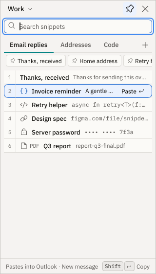
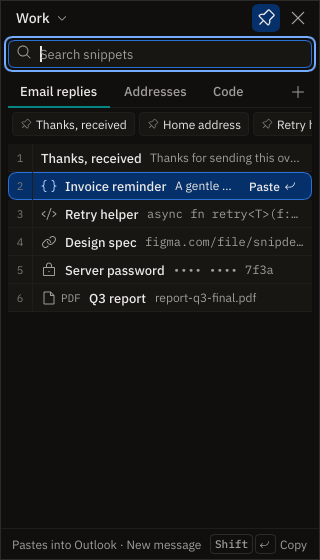
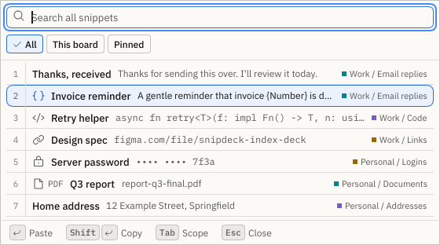
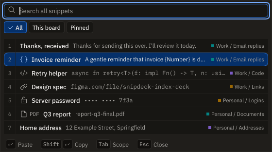

# Snipdeck

A sticky-note-style snippet deck for your desktop: keep the things you paste all the time one click away, and paste them into whatever you were typing in.

[](https://github.com/Braydenh563/Snipdeck/actions/workflows/ci.yml)


[](LICENSE)

> **Status: work in progress, not released.** There is no installer and no stable build. The
> library engine (data model, storage, templates, encryption, import/export) is built and tested on
> Linux CI. The Panel runs as a demo. The Picker, the Main window, the editors and the
> template fill form are not usable in the app yet. Everything that touches Windows (paste, hotkeys,
> tray, DPI, IME) is written but **has not been verified on a real Windows machine** except what
> [`docs/spikes/`](docs/spikes/README.md) records. See [What works today](#what-works-today).

## What it is

Clipboard-history tools bury the things you reuse in noise, and text expanders need memorised
abbreviations. Snipdeck is a curated deck: boards, lists and items you arrange yourself, shown in a small
always-on-top panel at the edge of the screen. Click an item and it is pasted into the app you were
using, without the panel taking focus away from it. Product behaviour is specified in
[`docs/SPEC.md`](docs/SPEC.md); the look in [`DESIGN.md`](DESIGN.md).

Windows 10 (1903+) and 11 first. Rust and [Slint](https://slint.dev), software renderer. macOS and
Linux builds are not planned for v1.

## Screenshots

These are the UI golden images that the test suite renders headlessly with Slint's software
renderer (`crates/snipdeck-ui/tests/golden/`), with seeded demo data. They are not captured from a
Windows desktop.

| Panel, light | Panel, dark |
|---|---|
|  |  |

| Picker, light | Picker, dark |
|---|---|
|  |  |

The Picker window exists and is tested, but the app does not open it yet.

## What works today

"Tested" means automated tests run in CI on Linux. "Unverified" means the code exists and compiles
for Windows but nobody has run it on Windows.

### Working now

| Area | State |
|---|---|
| Domain model: boards, lists, items, formats (text, HTML, RTF, PNG, files), tags | Tested |
| Template engine: `{date}`, `{time}`, `{datetime:FORMAT}`, `{clipboard}`, `{cursor}`; prompted `{field:...}` and `{choice:...}` (Pro) | Tested |
| In-memory fuzzy search over title, tags and the first 64 characters (`nucleo`) | Tested |
| SQLite store: migrations, FTS5 search, blob store, ordering, trash, single-writer lock | Tested |
| Encryption of sensitive items (XChaCha20-Poly1305, optional Argon2id master password) | Tested; no UI yet; the Windows DPAPI key binding is unverified |
| `.snipdeck` export/import, folder / Ditto / CopyQ-JSON importers, daily backups | Tested at library level; no UI yet |
| Offline Ed25519 licence verification | Tested; not wired into the app |
| Windows platform layer: clipboard with delayed rendering, paste, Target tracking, global hotkeys, tray, autostart, single instance | Written; **unverified on Windows** |
| UI component library, Panel, Picker and template fill windows, light and dark, translation catalogues for 7 locales (incomplete; missing strings show in English) | Golden-image and accessibility-tree tests; looks unverified on Windows |
| Panel in the app (`--demo`): search, arrow and number keys, use / copy, list tabs, board switcher, pinned strip, toasts | Headless window tests; Windows behaviour unverified |

What the demo does not do: it cannot add, edit or delete items, there is no Settings window, and the
Picker, quick capture and paste-next hotkeys are registered but do nothing. On Linux the demo uses a
fake clipboard and a pretend target window, so nothing is really pasted. On Windows it uses the real
services (unverified).

### Planned

Not started unless noted. Order follows [`docs/PLAN.md`](docs/PLAN.md).

- Picker wired to its hotkey; template fill form wired to the Panel and Picker (windows exist, M4)
- Main window (sidebar, item list, detail), editors for text and images, Trash and import/export screens (M4)
- Screen capture with OCR, opt-in Recent (clipboard history) inbox, sensitive-item UI, paste stack,
  floating lists, licence entry, onboarding, Settings window (M5)
- Installer (MSIX and MSI), signing, updater, winget manifest, performance and accessibility audits (M6)
- Windows clipboard history importer; the CopyQ binary `.cpq` export (see
  [`docs/PLAN.md`](docs/PLAN.md) "M1 known gaps")
- macOS and Linux are out of scope for v1.

## Quick start

You need Rust (the repo pins stable through `rust-toolchain.toml`). On Windows, also the Visual Studio
C++ Build Tools. The first build compiles SQLite and Slint and is slow; `target/` grows to several GB.

```sh
git clone https://github.com/Braydenh563/Snipdeck
cd Snipdeck

# Try the Panel on a seeded in-memory library (nothing is saved).
cargo run -p snipdeck-app -- --demo          # Windows: double-click run-snipdeck-demo.bat
cargo run -p snipdeck-app -- --demo --dark   # dark theme
cargo run -p snipdeck-app -- --screenshot panel.png   # render to a PNG; needs no display

# Tests and checks.
cargo test --workspace --locked
scripts/gate.sh            # fmt, clippy, docs, code map and translation checks
scripts/gate.sh --full     # the same plus the whole test suite
```

`cargo run` without `--demo` opens the real library in `%LOCALAPPDATA%\Snipdeck` (elsewhere
`$XDG_DATA_HOME/snipdeck` or `~/.local/share/snipdeck`), but there is nothing in the app to put items
into it yet. See [`CONTRIBUTING.md`](CONTRIBUTING.md) for the full developer workflow and
[`docs/troubleshooting.md`](docs/troubleshooting.md) if something does not build or run.

To test Windows behaviour, run `run-windows-tests.bat`: a wizard that builds the app, walks you through
the manual steps and writes a summary ([`tools/windows-test`](tools/windows-test/README.md)).

## Project layout

| Path | What |
|---|---|
| `crates/snipdeck-core` | Domain types, template engine, fuzzy search, entitlements, licence verification. Pure: no I/O, no OS calls. |
| `crates/snipdeck-store` | SQLite store, migrations, blob store, FTS5, trash, encryption at rest. |
| `crates/snipdeck-portable` | `.snipdeck` archives, importers (folder, Ditto, CopyQ JSON), daily backups. |
| `crates/snipdeck-platform` | Clipboard, keyboard, hotkeys, Target tracking, tray, DPAPI, autostart, single instance. Traits, fakes and the Windows backend. The only crate that writes `unsafe` code (Slint's generated code aside). |
| `crates/snipdeck-ui` | Slint design tokens, components, Panel / Picker / fill-form windows, translations, headless test harness. |
| `crates/snipdeck-app` | The binary: controller, use cases, settings, view-models, tray and hotkey wiring. |
| `design/` | Colour palette source and generator. |
| `tools/windows-test/` | The Windows test wizard and its manual and automated steps. |
| `spikes/` | Throwaway M0 prototypes, outside the workspace. |
| `docs/` | Specification, plan, ADRs, format and storage docs, reviews. Index: [`docs/README.md`](docs/README.md). |

## Privacy and security

- **Local-first.** Your library is a SQLite file and a blob folder on your disk. No account, no server, no
  network port, no telemetry. The only setting that could make a network call (site icons for links)
  is off by default.
- **Open data.** Export is a plain zip with JSON ([`docs/format.md`](docs/format.md)).
- **Sensitive items** are masked in the UI and excluded from history. In the Pro tier they are also
  encrypted at rest with a key wrapped by Windows DPAPI and optionally a master password
  ([`docs/crypto.md`](docs/crypto.md)). Titles, tags and search text are not encrypted. The
  encryption has not been tested on Windows.
- **Licence keys** are verified offline; there is no phone-home ([`docs/licensing.md`](docs/licensing.md)).

To report a vulnerability, see [`SECURITY.md`](SECURITY.md).

## Documentation

[`docs/README.md`](docs/README.md) indexes everything. Start with
[`docs/user-guide.md`](docs/user-guide.md) (what the app does and which parts exist yet),
[`docs/development.md`](docs/development.md) (code tour and test strategy),
[`docs/SPEC.md`](docs/SPEC.md) and [`docs/PLAN.md`](docs/PLAN.md).
Handover notes for the current state are in [`docs/HANDOVER.md`](docs/HANDOVER.md);
history is in [`CHANGELOG.md`](CHANGELOG.md).

## Contributing

Issues and pull requests are welcome; read [`CONTRIBUTING.md`](CONTRIBUTING.md) first. Everyone taking part
follows the [Code of Conduct](CODE_OF_CONDUCT.md).

## Licence

[GPL-3.0-only](LICENSE). A Pro tier is unlocked by an offline licence key
([ADR-0005](docs/adr/0005-licensing-and-pro.md)); the source of every feature is in this repository.
Contributors sign a CLA so the project can offer other licences later.
