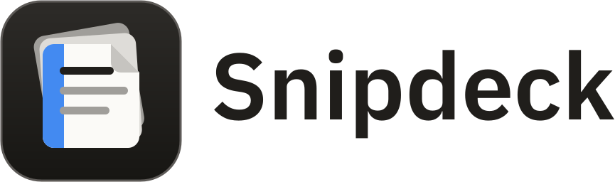
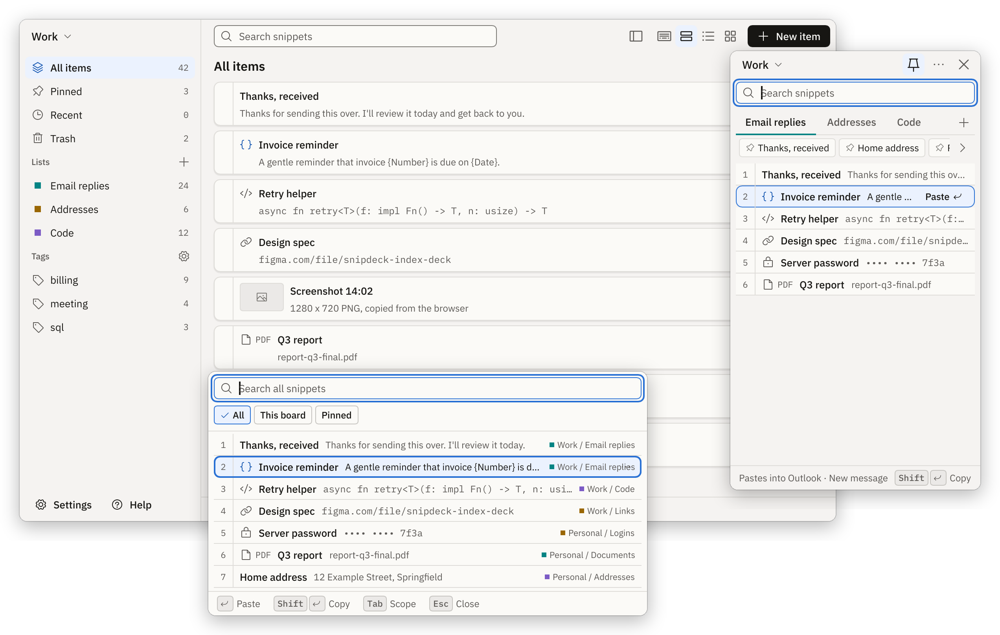
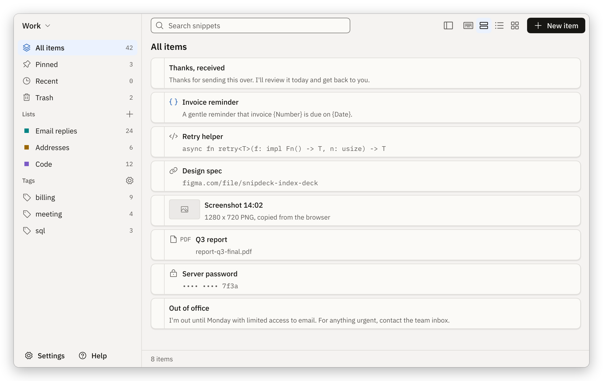
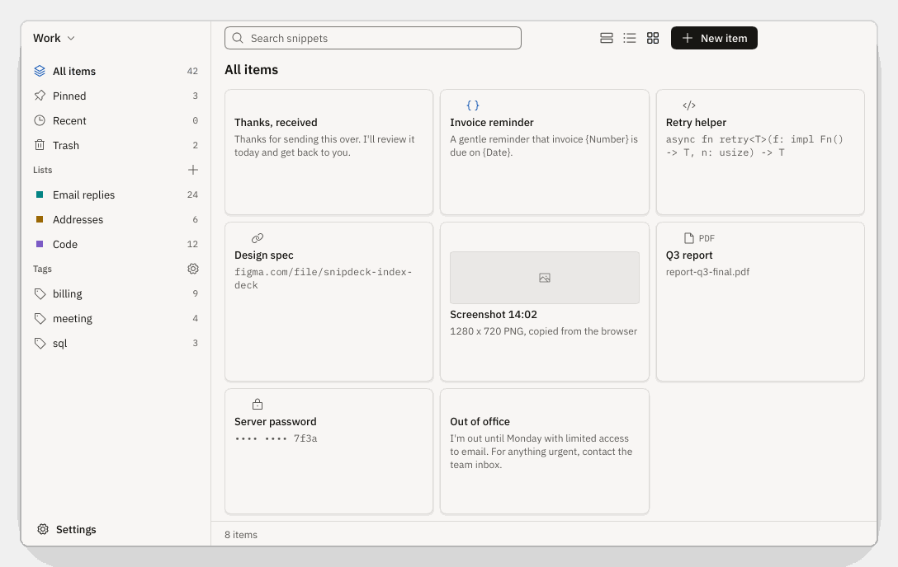
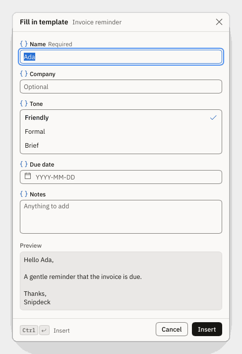
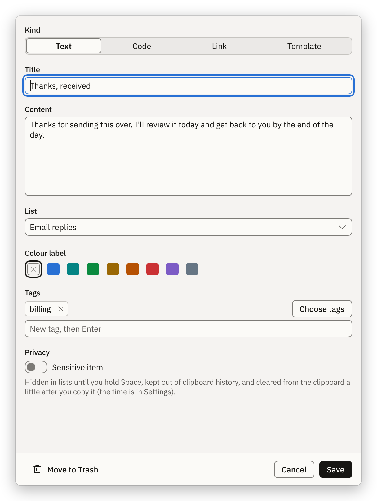
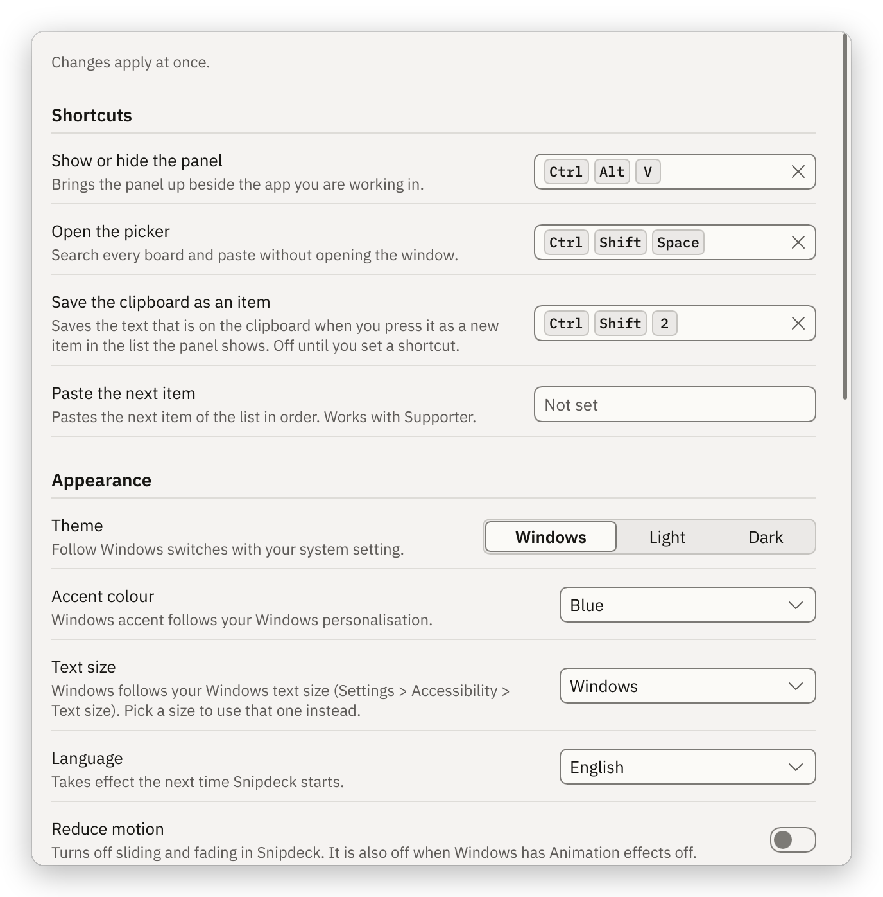

<picture><source media="(prefers-color-scheme: dark)" srcset="assets/logo/snipdeck-logo-dark.svg"></picture>

**Your reusable snippets, one click from any app.**

[Install](#install) · [Features](#features) · [Tour](#a-quick-tour) · [Hotkeys](#hotkeys) · [Privacy](#privacy) · [User guide](docs/user-guide.md) · [Troubleshooting](docs/troubleshooting.md)

Snipdeck is a snippet deck for Windows. Keep the text, links, templates, images and files you paste all the
time on a small panel at the edge of your screen. Click one and it lands in the app you were typing in. The
panel never takes focus from that app.

You arrange the deck yourself. Boards hold lists, lists hold items. It is not a clipboard history.

<picture><source media="(prefers-color-scheme: dark)" srcset="docs/images/hero-dark.png"></picture>

> [!NOTE]
> Snipdeck 1.0 is not released yet. It is tested on Linux, and its Windows behaviour has had limited checks on
> a real PC, so expect rough edges.

## Install

1. Download `snipdeck-<version>-windows-x64.zip` from [Releases](https://github.com/Braydenh563/Snipdeck/releases/latest)
   and unzip it.
2. Double-click `Snipdeck.bat`.

The first start downloads the app once and checks it. After that Snipdeck starts straight away, offline. You
do not need Rust, Visual Studio or git.

You need Windows 10 (1903 or newer) or Windows 11, 64-bit.

Launcher commands, and how to uninstall

Type these as `Snipdeck.bat <command>`, or double-click the matching file in `tools\launcher\commands`.

| Command | What it does |
|---|---|
| `update` | Downloads the newest release. Your library is kept. |
| `reinstall` | Installs the app again. The old copy stays if the download fails. |
| `backup`, `restore` | Zip your library to `Documents\Snipdeck-backups`, or put a backup back. |
| `doctor` | Checks this PC and your data and writes a report you can send. |
| `logs` | Shows the newest launcher log. |
| `uninstall` | Removes the app and keeps your library. Add `--data` to erase the library too. |
| `help` | Lists every command and option. |

More in [`tools/launcher/README.md`](tools/launcher/README.md).

## Features

- **Panel.** A small always-on-top window with your current board. It can dock to a screen edge and fold
  into a thin strip. Lists show as tabs, and pinned items sit in a strip under them.
- **Picker.** A search box at your text caret. It searches every board. Type, press <kbd>Enter</kbd>, done.
- **Main window.** Boards, lists, tags, Pinned and Trash. Compact, comfortable and tile views, search,
  multi-select and keyboard reordering.
- **Six kinds of item.** Text, code, link, template, image and file.
- **Templates.** Insert `{date}`, `{time}` or your own date format. Pro adds fields and choices that ask you
  for a value each time.
- **Quick capture.** Press <kbd>Ctrl</kbd>+<kbd>Shift</kbd>+<kbd>2</kbd> to save the clipboard text as a new item.
- **Sensitive items.** Hidden in lists, kept out of Windows clipboard history, and encrypted on disk with Pro.
- **Safe to change.** Deleted things stay in the Trash for 30 days, with Undo. Daily backups are automatic.
- **Your way.** Light, dark or Windows theme, seven languages, and hotkeys you can change.

## A quick tour

<table>
<tr>
<td width="50%" valign="top">

<picture><source media="(prefers-color-scheme: dark)" srcset="docs/images/panel-dark.png"></picture>

**The Panel.** Your board on the edge of the screen. Click an item and it pastes where you were typing.

</td>
<td width="50%" valign="top">

<picture><source media="(prefers-color-scheme: dark)" srcset="docs/images/picker-dark.png"></picture>

**The Picker.** A search box at your caret. Type a few letters and press <kbd>Enter</kbd>.

</td>
</tr>
<tr>
<td width="50%" valign="top">

<picture><source media="(prefers-color-scheme: dark)" srcset="docs/images/main-dark.png"></picture>

**The Main window.** Organise boards, lists and tags. Search, multi-select and reorder from the keyboard.

</td>
<td width="50%" valign="top">

<picture><source media="(prefers-color-scheme: dark)" srcset="docs/images/main-tile-dark.png"></picture>

**Tile view.** The same items as cards, for images and files.

</td>
</tr>
<tr>
<td width="50%" valign="top">

<picture><source media="(prefers-color-scheme: dark)" srcset="docs/images/fill-dark.png"></picture>

**Template fill.** Templates ask for their fields, with a live preview of the result.

</td>
<td width="50%" valign="top">

<picture><source media="(prefers-color-scheme: dark)" srcset="docs/images/editor-dark.png"></picture>

**Item editor.** Text, code, links, templates, images and files, with a sensitive switch.

</td>
</tr>
<tr>
<td width="50%" valign="top">

<picture><source media="(prefers-color-scheme: dark)" srcset="docs/images/settings-dark.png"></picture>

**Settings.** Hotkeys, theme, language, dock edge, backups and privacy in one page.

</td>
<td width="50%" valign="top">

<picture><source media="(prefers-color-scheme: dark)" srcset="docs/images/help-dark.png"></picture>

**Help.** A troubleshooting checklist with a fix button for each problem it finds.

</td>
</tr>
</table>

Screenshots are rendered from the app's own interface by the test suite, in light and dark to match your GitHub theme.

## Hotkeys

| Hotkey | Action |
|---|---|
| <kbd>Ctrl</kbd>+<kbd>Alt</kbd>+<kbd>Space</kbd> | Show or hide the Panel |
| <kbd>Ctrl</kbd>+<kbd>Shift</kbd>+<kbd>Space</kbd> | Open the Picker |
| <kbd>Ctrl</kbd>+<kbd>Shift</kbd>+<kbd>2</kbd> | Save the clipboard text as a new item |
| <kbd>Ctrl</kbd>+<kbd>Alt</kbd>+<kbd>V</kbd> | Paste the next pinned item or list item (Pro) |

Change any of them in Settings. If another program owns a hotkey, Snipdeck says so and the rest keep working.

More keys

| Where | Keys | Action |
|---|---|---|
| Panel, Main window | <kbd>Enter</kbd>, <kbd>Shift</kbd>+<kbd>Enter</kbd> | Paste, or copy only |
| Panel, Picker | <kbd>1</kbd> to <kbd>9</kbd> | Use that row while the search box is empty |
| Panel, Main window | <kbd>Ctrl</kbd>+<kbd>E</kbd> or <kbd>F2</kbd> | Edit the selected item |
| Panel, Main window | <kbd>Ctrl</kbd>+<kbd>F</kbd> | Search |
| Picker | <kbd>Tab</kbd> | Switch between All, This board and Pinned |
| Main window | <kbd>Ctrl</kbd>+<kbd>N</kbd> | New item |
| Main window | <kbd>Ctrl</kbd>+<kbd>P</kbd> | Pin or unpin |
| Main window | <kbd>Alt</kbd>+<kbd>Up</kbd>, <kbd>Alt</kbd>+<kbd>Down</kbd> | Move an item or list |
| Editor, fill form | <kbd>Ctrl</kbd>+<kbd>Enter</kbd> | Save, or insert |

The full list is in the [user guide](docs/user-guide.md#keyboard-reference).

If the Panel is hidden

Closing the Panel hides it to the tray and Snipdeck keeps running. Press <kbd>Ctrl</kbd>+<kbd>Alt</kbd>+<kbd>Space</kbd>,
left-click the tray icon, or right-click it and choose **Open Panel**. Starting Snipdeck a second time also
brings the running copy forward.

## Privacy

Snipdeck works fully offline. It has no account, no server and no telemetry, and it opens no network port.
Icons and fonts are packaged with the app. Your library stays on your PC in `%LOCALAPPDATA%\Snipdeck`.

What is stored, and how to export or remove it

- The library, large content, settings, backups and crash logs are all in that one folder.
- Crash logs are never sent anywhere and do not quote your snippets.
- **Export:** Settings, Your data, Export library saves one `.snipdeck` file (a zip with JSON).
- **Remove everything:** quit Snipdeck, then delete the folder.

Details: [`docs/privacy.md`](docs/privacy.md).

## Free and Pro

Snipdeck is free software under [GPL-3.0-only](LICENSE). Free covers everyday use with up to 3 boards. Pro
adds more boards, templates that ask for values, encryption of sensitive items and paste next. Enter a key
under **Licence** in Settings. See [`docs/licensing.md`](docs/licensing.md).

## Help and contributing

- Something wrong? Start with [Troubleshooting](docs/troubleshooting.md), or run `Snipdeck.bat doctor`.
- Build from source, run the tests and send a change: [`CONTRIBUTING.md`](CONTRIBUTING.md).
- What changed: [`CHANGELOG.md`](CHANGELOG.md). Report a vulnerability as [`SECURITY.md`](SECURITY.md) describes.
- Everyone taking part follows the [Code of Conduct](CODE_OF_CONDUCT.md).
